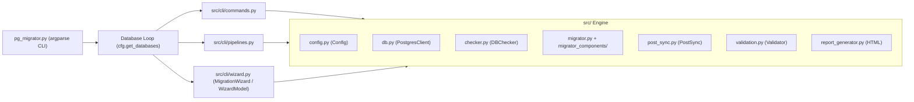

# Codebase Architecture & Reference

This document provides a comprehensive overview of the `pg_logical_migrator` codebase. It details the project's architecture, core modules, classes, and their responsibilities.

---

## High-Level Architecture

The project is a modular Python application providing both a Command Line Interface (CLI) and an Interactive Wizard. It is built around single-responsibility classes managing logical replication phases (diagnostics, setup, post-sync, and validation).

### Architecture Overview



### Directory Structure

```text
pg_logical_migrator/
├── pg_migrator.py               # Main CLI entry point (27 subcommands)
├── pg_migrator_completion.sh    # Bash completion for CLI and dist binary
├── pyproject.toml               # Build & package metadata
├── src/                         # Core Python modules
│   ├── config.py                # Configuration management (.ini, multi-schema)
│   ├── db.py                    # PostgresClient wrapper, pooling, redaction
│   ├── schema_utils.py          # Schema filter SQL generation
│   ├── checker.py               # Pre-flight diagnostics and size analysis
│   ├── migrator.py              # Facade composing migrator_components/
│   ├── migrator_components/     # Modular replication & migration internals
│   │   ├── data_sync.py         # Large Objects & UNLOGGED table synchronization
│   │   ├── monitoring.py        # Initial sync polling & byte progress tracking
│   │   ├── replication.py       # Publication, subscription, reverse replication
│   │   └── schema.py            # Pre-data and post-data pg_dump/psql execution
│   ├── post_sync.py             # Sequences, triggers, matviews, ownership
│   ├── validation.py            # Object and data parity auditing
│   ├── report_generator.py      # Self-contained HTML audit reports
│   └── cli/                     # CLI & Wizard interfaces
│       ├── commands.py          # Individual step command wrappers
│       ├── pipelines.py         # Automated pipelines (init-replication, post-migration)
│       ├── helpers.py           # Logging, formatting, sample INI generator
│       └── wizard.py            # Rich-based interactive MigrationWizard (MVC)
├── docs/                        # Canonical Diátaxis portal + design specs
├── DOCS/                        # Technical architecture and CI references
├── PROJECT/                     # Project governance, specs, and milestones
├── releases/                    # Versioned release notes (v1.0.0 - v1.4.1)
├── tests/                       # Test suite (Unit, Integration, E2E)
│   ├── unit/                    # 290 baseline unit tests — no Docker required
│   ├── integration/             # 24 wizard + Docker connectivity tests
│   └── e2e/                     # Full 17-step Pagila + packaging tests
├── .flake8                      # Legacy Flake8 directory exclusions
├── .github/workflows/           # CI/CD pipelines
│   ├── python-package.yml       # Ruff, mypy, full test suite, GHCR, wheel/sdist
│   ├── pyinstaller-publish.yml  # Standalone binaries + DEB/RPM + GitHub Release
│   └── docker-publish.yml       # Docker Hub publish
└── test_env/                    # Docker Compose environment for testing
```

---

## Core Modules & Classes

### 1. Configuration (`src/config.py`)
- **Class `Config`**: Reads `config_migrator.ini`.
- **Multi-Schema Support**: The `target_schema` setting supports `public` (default), `all` (every user schema), or a comma-separated list.
- **Method `get_target_schemas()`**: Returns the list of targeted schemas or `['all']`.

### 2. Database Interaction (`src/db.py`)
- **Class `PostgresClient`**: Wrapper around `psycopg` (v3) for SQL execution and connection management.
- **Utility `pretty_size(bytes)`**: Formats byte counts into human-readable strings (kB, MB, GB).

### 3. Diagnostics & Pre-flight (`src/checker.py`)
- **Class `DBChecker`**:
  - `check_problematic_objects()`: Scans for missing PKs, LOBs, identity columns, etc.
  - `get_database_size_analysis()`: Calculates total database size and per-table breakdown (Data, Index, % DB footprint).
  - All diagnostics respect the `target_schema` filtering when a `Config` object is provided.

### 4. Migration Execution (`src/migrator.py`)
- **Class `Migrator`**:
  - `step4a_...()` & `step4b_...()`: Subprocess-based `pg_dump` for pre-data and post-data schema sections.
  - `step5_setup_source()`: Creates the Publication. Uses `FOR TABLES IN SCHEMA` if specific schemas are targeted.
  - `wait_for_sync(timeout, show_progress=True)`: Polls `pg_subscription_rel` until all tables are ready. Displays real-time progress.
  - `get_initial_copy_progress()`: Returns detailed byte-level and table-count synchronization status.

### 5. Post-Synchronization (`src/post_sync.py`)
- **Class `PostSync`**:
  - `refresh_materialized_views()`, `sync_sequences()`, `enable_triggers()`.
  - `reassign_ownership(target_owner)`: Changes owner for all migrated objects, intelligently excluding internal table-row types.
  - All operations filter by the targeted schemas defined in the config.

### 6. Validation & Auditing (`src/validation.py`)
- **Class `Validator`**:
  - `audit_objects()`: Structural parity check (TABLE, VIEW, INDEX, etc.).
  - `compare_row_counts(use_stats=False)`: Data parity check. If `use_stats` is True, uses `pg_stat_user_tables` for near-instant estimation on large tables.

---

## User Interfaces

### Command Line Interface (CLI)
- **`pg_migrator.py`**: Entry point using `argparse` (`27` subcommands) with sequential multi-database looping via `Config.get_databases()`.
- **`src/cli/pipelines.py`**: Orchestrates high-level workflows:
  - `init-replication`: Steps 1-6 + optional `wait_for_sync` (`--wait`) + Step 14/15 validation -> `report_init.html`.
  - `post-migration`: `wait_for_sync` + Step 10 (Terminate) + Step 8 (MatViews) + Step 9 (Sequences) + Step 10.2 (Post-Data) + Step 11a/11b (LOBs/UNLOGGED) + Step 12 (Triggers) + Step 13 (Ownership) + Step 14/15 validation -> `report_post.html`.

### Interactive Wizard
- **`src/cli/wizard.py` (`cmd_wizard`, `MigrationWizard`, `WizardModel`, `WizardView`)**: A Rich-based MVC assistant with database discovery, state detection, and `--non-interactive` support.

---

## Error Handling and Logging

- **Logging**: Centrally configured in `src/cli/helpers.py` via `setup_logging()`. Both console and file handlers are supported.
- **Pipeline Reliability**: Automated pipelines wrap critical steps in `try/except` blocks and generate `report_init_error.html` or `report_post_error.html` on fatal failures.

---

## Test Infrastructure

The baseline unit suite contains **290 unit tests** (`69%` unit-only coverage on `src/`; full CI coverage passes the `70%` gate when including `tests/integration/test_wizard*.py`). See [DOCS/TESTING.md](TESTING.md) for the full reference.

### Makefile Targets

| Target | Description |
|---|---|
| `make test-unit` | Run unit tests (`tests/unit`, no Docker) |
| `make test-coverage` | Unit tests + coverage report (HTML + terminal, `--cov-fail-under=70`) |
| `make test-integration` | Integration tests (`test_wizard.py` + Docker tests) |
| `make test-e2e` | End-to-end migration test (requires Docker) |
| `make test-packaging` | Binary + DEB/RPM + wheel packaging validation |
| `make test-all` | All of the above in sequence |
| `make test-report` | Unit tests + HTML report + full pipeline run |
| `make env-up` | Start Docker test environment (PostgreSQL 16/17 + Pagila) |
| `make env-down` | Tear down Docker environment |
