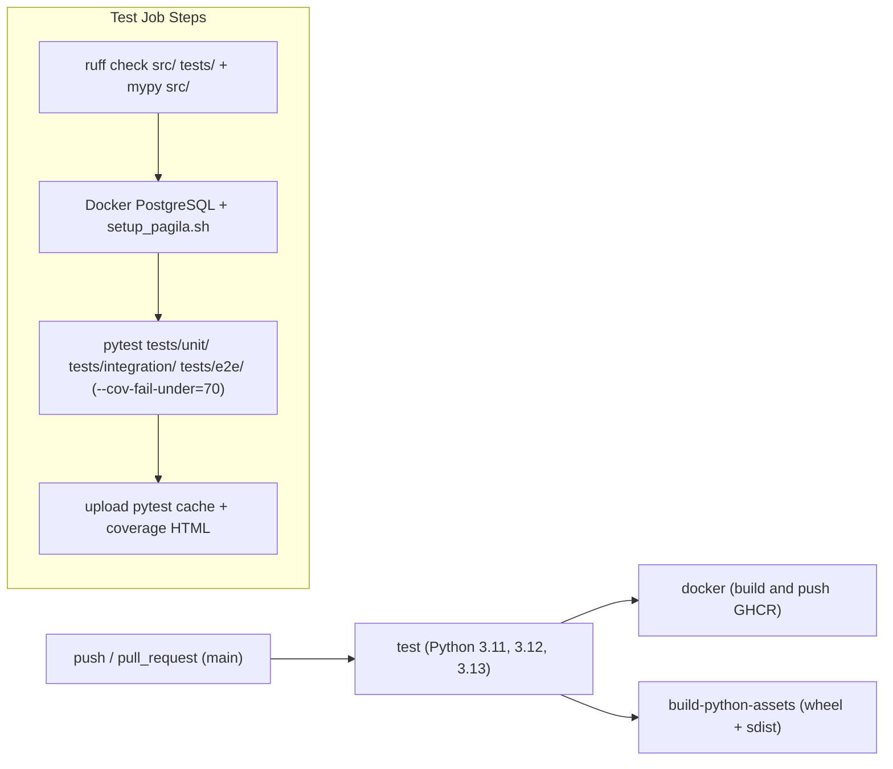
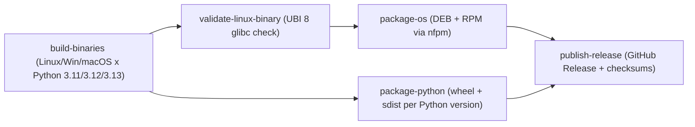
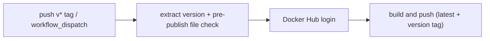

# Testing Infrastructure

`pg_logical_migrator` maintains a comprehensive, multi-layer test suite designed to validate correctness at every level — from individual functions to full end-to-end migration pipelines and CI/CD packaging workflows.

---

## Test Structure

```text
tests/
├── unit/                          # Fast, dependency-free unit tests (run in CI)
│   ├── test_checker.py            # DBChecker diagnostics
│   ├── test_checker_extended.py   # Edge cases: apply, pending_restart, schema filters
│   ├── test_cli.py                # CLI wrapper tests (sync-lobs)
│   ├── test_cli_commands.py       # All CLI subcommands
│   ├── test_cli_commands_extended.py  # Dry-run, error paths, edge branches
│   ├── test_cli_pipelines.py      # init-replication / post-migration pipelines
│   ├── test_config.py             # Config parsing and multi-schema helpers
│   ├── test_config_save.py        # Config section updates and serialization
│   ├── test_db.py                 # PostgresClient pooling, identifier sanitization, redaction
│   ├── test_docs_tutorials_howtos.py  # Tutorial/CLI execution, Diátaxis, STE, Mermaid checks
│   ├── test_github_workflows.py   # GitHub Actions YAML structure & contracts (requires: pyyaml)
│   ├── test_helpers.py            # CLI helpers: logging, formatting, config
│   ├── test_migrator.py           # Core migrator steps (basic cases)
│   ├── test_migrator_extended.py  # Complex branches: drop_dest, LOBs, timeouts
│   ├── test_migrator_lobs.py      # Large Object synchronization edge cases
│   ├── test_migrator_reverse_block.py  # Reverse replication safety checks
│   ├── test_migrator_unlogged.py  # UNLOGGED table synchronization checks
│   ├── test_post_sync.py          # PostSync basic operations
│   ├── test_post_sync_extended.py # Error paths, disable_triggers, reassign_ownership
│   ├── test_report_generator.py   # HTML report generation
│   ├── test_schema_utils.py       # Schema filter resolution helpers
│   └── test_validation.py         # Row-count and object-audit validation
│
├── integration/                   # Wizard unit-mocked + DB integration suites
│   ├── test_destructive_workflow.py
│   ├── test_non_interactive_wizard.py
│   ├── test_steps.py
│   ├── test_wizard.py
│   ├── test_wizard_commands.py
│   └── test_wizard_config.py
│
└── e2e/                           # Full migration & packaging tests (requires Docker)
    ├── test_compiled_binary.py
    ├── test_full_migration.py     # 17-step migration with Pagila dataset
    └── test_release_artifacts.sh
```

---

## Running Tests

### Prerequisites

```bash
# Create virtualenv and install dependencies
make install
# Note: pyyaml is required by test_github_workflows.py and is listed in requirements.txt
```

### Unit Tests (no Docker required)

```bash
# Run all unit tests
make test-unit

# Run with verbose output
PYTHONPATH=. venv/bin/pytest tests/unit -v

# Run a specific test file
PYTHONPATH=. venv/bin/pytest tests/unit/test_migrator_extended.py -v
```

### Coverage Report

```bash
# Generate terminal + HTML coverage report (CI threshold: 70%)
make test-coverage

# Manual invocation
PYTHONPATH=. venv/bin/pytest tests/unit \
    --cov=src \
    --cov-report=term-missing \
    --cov-report=html:RESULTS/coverage \
    --cov-fail-under=70
```

**Baseline suite**: **301 unit tests** pass without Docker (covering `src/` plus `docs/`, with `src/cli/wizard.py` covered by `tests/integration/test_wizard*.py`). Together with the **24** integration tests and **2** E2E tests in CI (Python `3.11 / 3.12 / 3.13`), coverage exceeds the `70%` gate.

| Core Module (Unit Only) | Coverage |
|---|---|
| `src/post_sync.py` | 99% |
| `src/report_generator.py` | 100% |
| `src/schema_utils.py` | 100% |
| `src/cli/pipelines.py` | 98% |
| `src/checker.py` | 96% |
| `src/cli/helpers.py` | 94% |
| `src/migrator_components/data_sync.py` | 95% |
| `src/validation.py` | 90% |
| `src/migrator_components/monitoring.py` | 90% |
| `src/migrator_components/replication.py` | 89% |
| `src/cli/commands.py` | 87% |
| `src/migrator_components/schema.py` | 83% |

### Integration Tests (requires Docker)

```bash
# Start test environment (PostgreSQL source + destination)
make env-up

# Run integration tests
make test-integration

# Stop environment
make env-down
```

### End-to-End Tests (requires Docker + Pagila dataset)

```bash
make env-up
make test-e2e
```

### Packaging Tests

```bash
make test-packaging
```

Tests PyInstaller binary on AlmaLinux 8/9, Ubuntu 22.04. Verifies:
- Binary execution (`--help`)
- glibc backward compatibility (UBI 8 container)
- DEB and RPM package integrity
- Python wheel install and import

### All Tests

```bash
make test-all
```

Runs: unit → integration → e2e → packaging (in sequence).

---

## GitHub Actions Workflow Tests

The file `tests/unit/test_github_workflows.py` validates the CI/CD pipeline definitions **offline**, without executing them on GitHub. This ensures pipeline regressions are caught during local development.

### What is tested

| Category | Tests |
|---|---|
| **YAML Validity** | All 3 workflow files parse without errors |
| **Trigger Rules** | Push/PR triggers, tag patterns (`v*`), workflow_dispatch |
| **Job Dependencies** | Correct `needs:` chain (test → docker → build-python-assets) |
| **Python Matrix** | CI covers Python 3.11, 3.12, 3.13 |
| **Permissions** | `packages: write` for GHCR push |
| **Binary Build** | UBI8 container for glibc compatibility |
| **Checksums** | SHA256 generated for all artifacts |
| **Tag Consistency** | Version mismatch check before release |
| **Docker Labels** | OpenContainers image labels |
| **Version Extraction** | Inline Python script logic simulation |
| **Packaging Contracts** | `Dockerfile`, `requirements.txt`, `LICENSE`, `releases/` |
| **Makefile Targets** | `test-unit`, `test-all`, `test-coverage` |
| **Release Notes** | Current version has non-empty release note file |

### Running workflow tests only

```bash
PYTHONPATH=. venv/bin/pytest tests/unit/test_github_workflows.py -v
```

---

## CI/CD Pipelines

### `python-package.yml` (CI — every push)

Triggered on every branch push and PR to `main`.



### `pyinstaller-publish.yml` (Packaging — v* tags/branches)

Triggered on `v*` tags (stable) or `v*` branches (prerelease) or `workflow_dispatch`.



### `docker-publish.yml` (Docker Hub — v* tags only)



---

## Writing New Tests

### Unit Test Pattern

```python
from unittest.mock import MagicMock, patch

def test_my_feature():
    cfg = MagicMock()
    cfg.get_target_schemas.return_value = ["all"]

    with patch("src.module.PostgresClient") as MockClient:
        MockClient.return_value.execute_query.return_value = []
        result = my_function(cfg)

    assert result is not None
```

### Mocking Guidelines

- **`PostgresClient`**: Always patch at `src.module.PostgresClient` (where it's imported)
- **`execute_shell_command`**: Patch at `src.db.execute_shell_command`
- **`Config`**: Use `MagicMock(spec=Config)` to catch method name errors
- **Return values**: Use `side_effect=[val1, val2, ...]` for multi-call mocks

### Adding GitHub Actions Tests

Tests for workflow contracts live in `test_github_workflows.py`. Add new assertions in the appropriate class:
- `TestPythonPackageWorkflow` — for `python-package.yml`
- `TestPyInstallerPublishWorkflow` — for `pyinstaller-publish.yml`
- `TestDockerPublishWorkflow` — for `docker-publish.yml`
- `TestPackagingArtifactContracts` — for file/directory presence
- `TestMakefileTargets` — for Makefile target validation

> **Note**: `on:` in YAML is parsed by PyYAML as Python `True`. Access it via:
> ```python
> self._on = self.wf.get("on") or self.wf.get(True, {})
> ```
