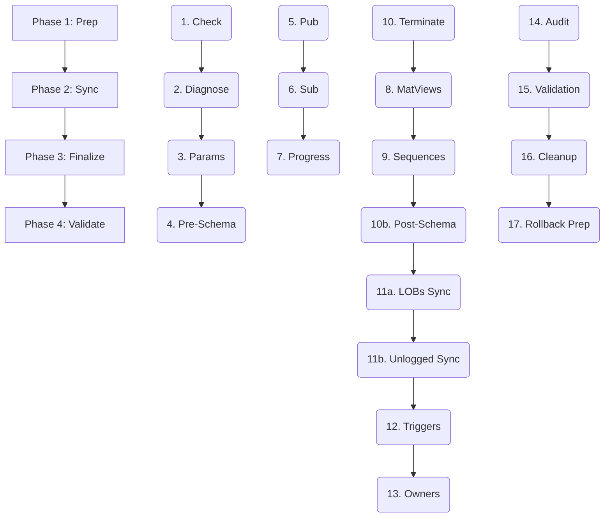

# Standardized 17-Step Workflow

**pg_logical_migrator** follows a strictly defined sequential workflow. Each step is designed to be independent, repeatable, and verifiable.

### 🧪 Phase 1: Preparation (Pre-flight)

1.  **Check Connectivity (`check`)**: Verify orchestrator reachability to both source and destination instances.
2.  **Diagnostics (`diagnose`)**: Scan for Primary Key coverage, Large Objects (LOBs), and unowned sequences.
3.  **Parameter Verification (`params`)**: Confirm mandatory settings (`wal_level=logical`, slots, workers).
4.  **Schema (Pre-Data) (`migrate-schema-pre-data`)**: Deploy base structures (schemas, tables, types, views).

### ⚡ Phase 2: Execution (Data Sync)

5.  **Setup Publication (`setup-pub`)**: Define the replication scope on the source.
6.  **Setup Subscription (`setup-sub`)**: Trigger initial data COPY and start logical change streaming.
7.  **Monitor Progress (`repl-progress`)**: Track byte-level and table-level synchronization status.

### 🏁 Phase 3: Finalization (Cutover Ready)

8.  **Refresh Materialized Views (`refresh-matviews`)**: Manually refresh non-replicated data in matviews.
9.  **Sync Sequences (`sync-sequences`)**: Align sequence values to prevent ID collisions after cutover.
10. **Terminate Replication (`terminate-repl`)**: Stop replication and remove forward subscription and publication.
10b. **Schema (Post-Data) (`migrate-schema-post-data`)**: Deploy indexes, foreign keys, and constraints.
11a. **Large Object Sync (`sync-lobs`)**: Manually migrate binary data (OIDs) and update table references.
11b. **UNLOGGED Table Sync (`sync-unlogged`)**: Manually synchronize UNLOGGED tables via COPY.
12. **Enable Triggers (`enable-triggers`)**: Restore application-level trigger logic on the target.
13. **Reassign Ownership (`reassign-owner`)**: Set correct role owners for all database objects.

### 🛡️ Phase 4: Validation & Cleanup

14. **Object Audit (`audit-objects`)**: Verify structural parity (counts of tables, indexes, views).
15. **Row Count Parity (`validate-rows`)**: Final check of data consistency across all tables.
16. **Cleanup (`cleanup`)**: Decommission replication slots and publication objects.
17. **Reverse Replication (`setup-reverse`)**: (Optional) Prepare a rollback path to sync changes back to source.

---

### 📊 Workflow Summary

---

### 🚀 Automated Pipelines

Instead of running individual steps manually, `pg_logical_migrator` provides two pipeline commands (`init-replication` and `post-migration`):

#### 1. Initialization Pipeline (`init-replication`)
Executes **Phase 1**, **Phase 2**, and initial verification:
- `check` (Step 1)
- `diagnose` (Step 2)
- `params` (Step 3)
- `migrate-schema-pre-data` (Step 4, optional `--drop-dest`)
- `setup-pub` (Step 5)
- `setup-sub` (Step 6)
- `wait_for_sync` (Step 7, executed only when `--wait` is passed)
- `audit-objects` (Step 14)
- `validate-rows` (Step 15, executed only when `--wait` is passed)
- **HTML Report**: `RESULTS/<timestamp>/report_init.html` (or `report_init_error.html`)

*Result: Replication is active and data is syncing in the background.*

#### 2. Cutover Pipeline (`post-migration`)
Executes **Phase 3** and **Phase 4** in the `v1.4.1` cutover order (`src/cli/pipelines.py`):
- `wait_for_sync` (Wait until initial/delta sync catches up)
- `terminate-repl` (Step 10: Stop replication)
- `refresh-matviews` (Step 8: Refresh materialized views)
- `sync-sequences` (Step 9: Synchronize sequence values)
- `migrate-schema-post-data` (Step 10b: Deploy indexes and foreign keys)
- `sync-lobs` (Step 11a: Synchronize Large Objects)
- `sync-unlogged` (Step 11b: Synchronize UNLOGGED tables)
- `enable-triggers` (Step 12: Enable triggers)
- `reassign-owner` (Step 13: Reassign ownership)
- `audit-objects` (Step 14: Object parity audit)
- `validate-rows` (Step 15: Row count parity)
- **HTML Report**: `RESULTS/<timestamp>/report_post.html` (or `report_post_error.html`)

*Result: The target database is independent, verified, and ready for production traffic.*

#### 3. Single-Database vs Multi-Database Execution
- In the **Wizard** (`pg_migrator.py wizard`), users select a target database interactively (or pass `--non-interactive`) for guided execution.
- In the **CLI**, `pg_migrator.py` iterates sequentially over all databases returned by `Config.get_databases()` (either `[source].database`, a comma-separated `[replication].databases`, or dynamic discovery via `databases = *`). Scope a CLI run to one database by configuring a single database in your `.ini` file (passed via `-c/--config`).
