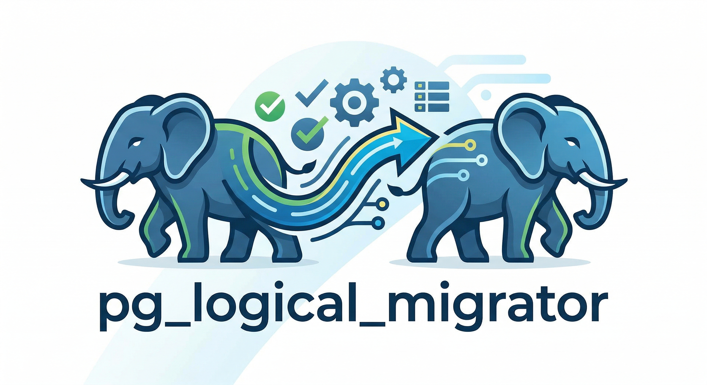

# Project Documentation Index

Welcome to the `pg_logical_migrator` project documentation. These files define the technical standards, roadmap, and requirements for a mission-critical PostgreSQL migration tool.

## 🎯 Project Status: **ACTIVE (v1.4.1)**

All 6 foundational milestones and the 17-step workflow (`27` CLI subcommands, Rich MVC Wizard, and automated two-phase pipelines) are implemented and verified against the Pagila dataset.

## Documentation Map

- **[CONSTITUTION.md](CONSTITUTION.md)**: Core principles, technical standards, and project governance.
- **[SPECIFICATIONS.md](SPECIFICATIONS.md)**: Technical requirements, Wizard design, and reporting framework.
- **[MILESTONES.md](MILESTONES.md)**: Initial v1.0 developmental roadmap *(all milestones completed)*.
- **[TASKS.md](TASKS.md)**: Initial v1.0 implementation checklist *(all tasks completed)*.
- **[PROGRESS.md](PROGRESS.md)**: Project health and milestone completion tracker.

## Quick Start

```bash
# Setup test environment
make env-up

# Run full automated migration with detailed HTML report
make test-report

# Run unit tests
make test-unit

# Open the latest report
ls RESULTS/
```
