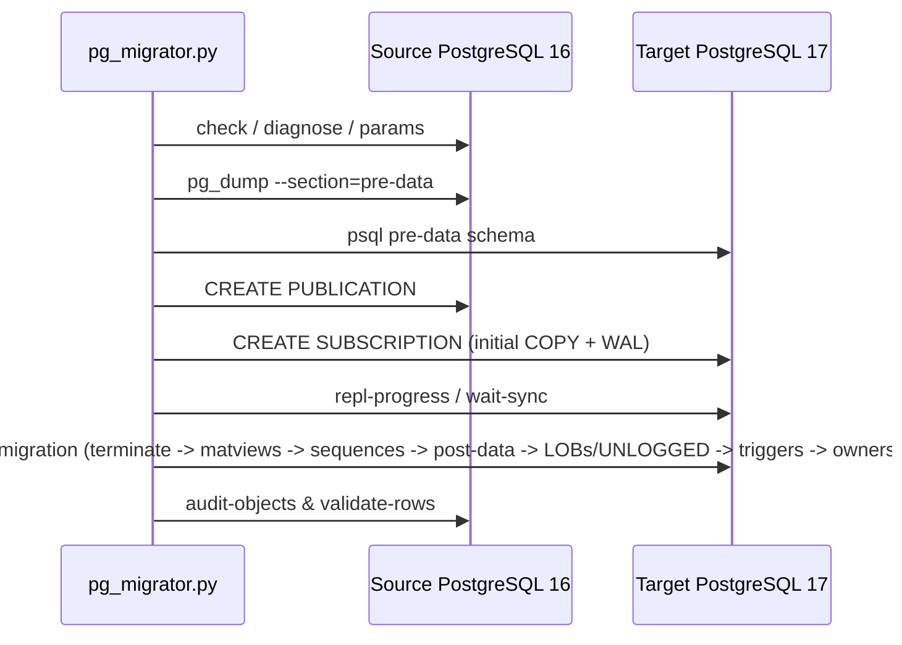

# Tutorial 2: Interactive Wizard and Two-Phase Pagila Pipeline

In this tutorial, you run a complete PostgreSQL 16 to PostgreSQL 17 migration locally using Docker Compose and the Pagila sample database.

## Prerequisites

- Docker and Docker Compose available locally.
- Repository cloned with test dependencies (`make install`).

## Step 1: Start the Docker Test Lab

Boot the `source_db` (PostgreSQL 16 on port `5432`) and `target_db` (PostgreSQL 17 on port `5433`) containers and load the Pagila dataset:

```bash
make env-up
```

Verify that both databases accept connections using the bundled test config (`tests/test_config.ini`):

```bash
PYTHONPATH=. python pg_migrator.py check -c tests/test_config.ini
```

## Step 2: Inspect the Two-Phase Migration Flow



## Step 3: Run `init-replication` Against the Sandbox

Initialize schema, publication, and subscription, dropping any leftover target database in the test sandbox:

```bash
PYTHONPATH=. python pg_migrator.py init-replication -c tests/test_config.ini --drop-dest --wait
```

Inspect the generated HTML report inside `RESULTS/<timestamp>/report_init.html`.

## Step 4: Finalize Cutover with `post-migration`

Execute the cutover pipeline once initial sync completes:

```bash
PYTHONPATH=. python pg_migrator.py post-migration -c tests/test_config.ini
```

Review `RESULTS/<timestamp>/report_post.html` to verify object parity and row counts across all Pagila tables.

## Step 5: Try the Interactive Wizard Mode

Launch the Rich terminal assistant for guided step-by-step inspections:

```bash
PYTHONPATH=. python pg_migrator.py wizard -c tests/test_config.ini
```

Use `--non-interactive` in CI/automation checks to execute detected pending steps automatically without interactive prompts.

## Step 6: Clean Up Containers

Tear down the sandbox containers when finished:

```bash
make env-down
```

## Next Steps

- Operational checklists: [Run a Two-Phase Migration](../02-how-to-guides/run-two-phase-migration.md).
- Architecture deep dive: [Architecture and Replication Lifecycle](../04-explanation/architecture-and-replication-lifecycle.md).
