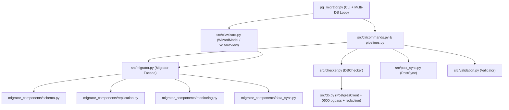

# Architecture and Replication Lifecycle

**pg_logical_migrator** coordinates native PostgreSQL logical replication (`CREATE PUBLICATION` / `CREATE SUBSCRIPTION`) around a stateless CLI and Rich MVC wizard without embedding state files on disk.

## Modular Engine Architecture

- **Stateless Orchestration**: Progress detection in `WizardModel` queries live PostgreSQL system catalogs (`pg_publication`, `pg_subscription`, `pg_subscription_rel`, `information_schema.tables`) rather than relying on local lockfiles.
- **Security Boundaries**: `src/db.py` applies `sanitize_identifier()` to dynamic DDL names, writes temporary `.pgpass` credentials with `0o600` permissions, runs subprocesses (`pg_dump | psql`) via `shell=False` pipelines (`pipe_shell_commands()`), and masks credentials via `redact_conninfo()`.

## Why Schema Deployment Splits `pre-data` and `post-data`

PostgreSQL `pg_dump --section=pre-data` emits table structures, types, views, and sequences without secondary indexes or foreign key constraints. Applying `pre-data` before creating the subscription provides two critical guarantees:

1. **Fast Initial Copy**: Subscriber `COPY` workers load table heaps rapidly without maintaining secondary index trees or validating foreign key constraints out of table order.
2. **Deferred Constraint Enforcement**: Deploying `--section=post-data` (`Step 10b`) only after logical replication finishes syncing rows ensures foreign keys and constraints never reject in-flight multi-table deltas.

## Why Cutover Orders Termination Before Finalization

In `v1.4.1`, `post-migration` runs `wait_for_sync()` -> **Terminate Replication (`Step 10`)** -> Refresh MatViews (`Step 8`) -> Sync Sequences (`Step 9`) -> **Post-Data (`Step 10b`)** -> LOBs (`Step 11a`) & UNLOGGED (`Step 11b`) -> Triggers (`Step 12`) -> Ownership (`Step 13`). Terminating forward replication first guarantees the destination is quiet and no late WAL apply workers overwrite synchronized sequence values or race against `post-data` index/constraint creation.

## Compensating for Native Logical Replication Limits

PostgreSQL logical decoding captures DML (`INSERT`, `UPDATE`, `DELETE`) on logged relational tables with Primary Keys or replica identities. **pg_logical_migrator** fills the remaining gaps explicitly:

- **Tables Without Primary Keys**: `setup-pub` sets `REPLICA IDENTITY FULL` so `UPDATE` and `DELETE` events remain decodable on the subscriber.
- **Large Objects (`pg_largeobject`)**: `sync-lobs` exports source OIDs and remaps destination `oid` columns using PK matching.
- **`UNLOGGED` Tables**: Because PostgreSQL omits unlogged writes from WAL, `sync-unlogged` truncates and copies those tables at cutover.
- **Reversible Cutover**: `setup-reverse` mirrors publication/subscription direction (`dest -> source`) after traffic switchover, preserving a fast failback path without re-cloning clusters.

For flag definitions and INI parameters, consult the [CLI Reference](../03-reference/cli-commands-and-configuration.md).
