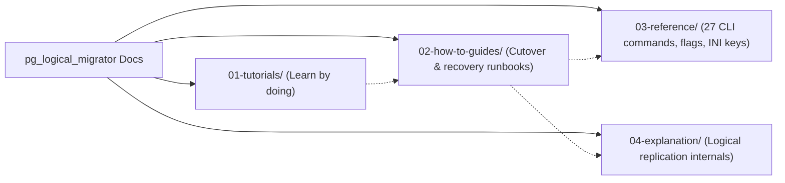

# pg_logical_migrator Documentation Portal

Welcome to the Diátaxis documentation portal for **pg_logical_migrator** (`v1.4.1`). Use the quadrant map below to jump straight to learning tutorials, ASD-STE100 operational runbooks, exact CLI/configuration specifications, or architectural explanations.

## Quadrants

| Quadrant | Focus | Entry Point |
| :--- | :--- | :--- |
| **Tutorials** | Step-by-step learning exercises in safe sandboxes | [01-tutorials/index.md](01-tutorials/index.md) |
| **How-To Guides** | ASD-STE100 Issue 9 procedures for cutover and recovery | [02-how-to-guides/index.md](02-how-to-guides/index.md) |
| **Reference** | Exact flags, subcommands, INI parameters, and exit codes | [03-reference/index.md](03-reference/index.md) |
| **Explanation** | Why the 17-step lifecycle separates pre-data and post-data | [04-explanation/index.md](04-explanation/index.md) |

## Companion Technical Docs

- [Root README](../README.md) — Project overview and Docker quickstart.
- [HOWTO.md](../HOWTO.md) — Legacy single-page cheat sheet and shell completion notes.
- [DOCS/README.md](../DOCS/README.md) — Technical architecture, CI workflow diagrams, and test infrastructure guides.
